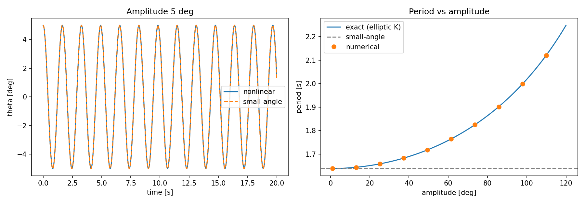

# Compound pendulum: Lagrangian model vs numerics

**Problem.** A rigid body swinging about a fixed horizontal axis. How does its motion depart from the small-angle (simple harmonic) approximation, and can a numerical model be checked against measurement?

**Method.** The Lagrangian `L = ½ I θ̇² + m g d cos θ` gives `I θ̈ = −m g d sin θ`. The script integrates this with `scipy.integrate.solve_ivp` (tight tolerances), also integrates the linearised equation, and compares both with the exact period `T = T₀ · (2/π) K(sin²(θ₀/2))` (complete elliptic integral).

**Result** (uniform rod, 1.175 kg, 1.0 m, pivoted at one end, 5° release):

- small-angle period 1.6380 s; exact 1.6387 s; numerical 1.6387 s (relative error ~2·10⁻⁹)
- the period grows with amplitude as predicted by the elliptic-integral curve (right panel)

**Validation against experiment.** `python pendulum.py --tracker data.csv` overlays video-tracking data (CSV with columns `t [s]`, `theta [deg]`) and prints the RMS error against the model. Set `--mass`, `--length` and `--amplitude` to your measured values.

**Notes.** Default parameters describe an ideal uniform rod and are not fitted to my Tracker measurements. A real bar differs through its pivot hole, non-uniform mass and damping.

Run: `python pendulum.py`
