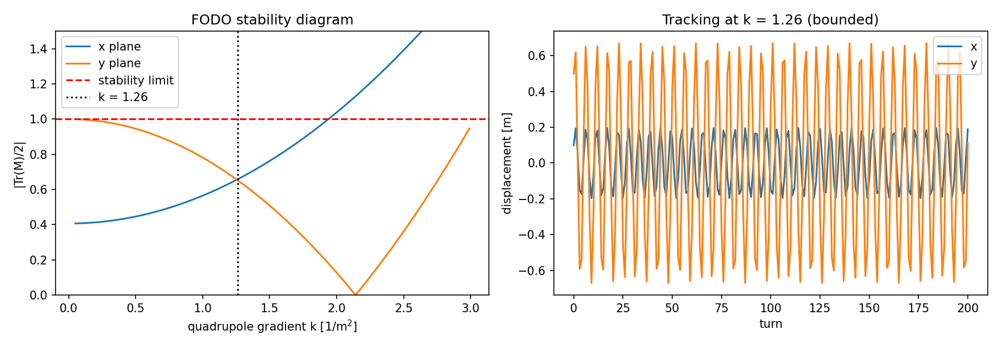

# Beam stability in a FODO ring

**Problem.** A ring made of repeated FODO cells (drift, defocusing quadrupole, dipole, focusing quadrupole) only keeps a beam bounded for some quadrupole strengths. Which strengths are stable, and which is most robust?

**Method.** 6×6 linear transfer matrices for drift, dipole and quadrupole elements act on the phase-space vector (x, x′, y, y′, z, δ). A cell is stable in a plane when |Tr M|/2 < 1. I scan the normalised gradient k, choose the value that maximises the stability margin (minimises max(|Tr M_x|, |Tr M_y|)/2), then track a particle for 200 turns. The bending radius is set to `R = N·L_dipole/2π` so the dipoles actually close the ring.

**Result.**

- stable for k up to ≈ 1.93 m⁻² (6 cells, 0.5 m quadrupoles, 1 m dipoles, 1 m drifts)
- most stable gradient k ≈ 1.26 m⁻² (max |Tr M|/2 = 0.66)
- at k = 1.26 the displacement stays bounded over 200 turns (max 0.67 m); at k = 2.5 it diverges

**Notes.**

- k is the normalised gradient in m⁻², not T/m.
- Linear, single-particle optics only: no space charge, chromaticity or nonlinear fields.
- An earlier version selected k = 0.6 by minimising orbit variance over only 10 turns and used a bending radius that did not close the ring. The stability-margin criterion here is cleaner and gives a different optimum.
- The transfer-matrix structure follows a standard accelerator-physics exercise (Wille, *The Physics of Particle Accelerators*).

Run: `python fodo.py`
