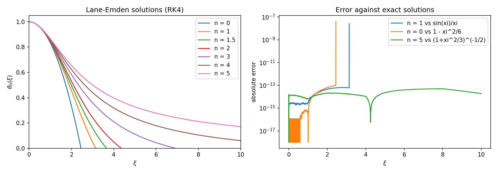

# Lane-Emden equation: polytropic stellar models

**Problem.** The Lane-Emden equation describes a self-gravitating polytropic sphere. It is singular at the centre and has closed-form solutions only for n = 0, 1, 5.

**Method.** The equation is written as a first-order system for θ and dθ/dξ and integrated with a fixed-step 4th-order Runge-Kutta scheme. Integration starts at ξ₀ = 10⁻⁴ from the series θ = 1 − ξ²/6 + nξ⁴/120 to avoid the singularity. The first zero ξ₁ (the stellar surface) is found by linear interpolation of the crossing.

**Result.** First zeros of θₙ compared with Chandrasekhar's table:

| n | ξ₁ (RK4) | ξ₁ (table) | relative error |
|---|---|---|---|
| 0 | 2.44949 | 2.4494 | 3.7·10⁻⁵ |
| 1 | 3.14159 | 3.14159 | 9·10⁻⁷ |
| 1.5 | 3.65375 | 3.65375 | 1·10⁻⁶ |
| 2 | 4.35287 | 4.35287 | 1·10⁻⁶ |
| 3 | 6.89685 | 6.89685 | 2·10⁻⁷ |
| 4 | 14.97155 | 14.97155 | 2·10⁻⁷ |

The right panel compares whole curves with the exact n = 0, 1, 5 solutions. The n = 0 difference comes from the table's rounding: the exact value is √6 = 2.449490.

**Notes.** n = 5 has no finite surface, so no zero is reported. An earlier version used an explicit Euler step with interpolation; it gave ξ₁ = 14.994 for n = 4. RK4 reduces that error by about three orders of magnitude.

Run: `python lane_emden.py`
