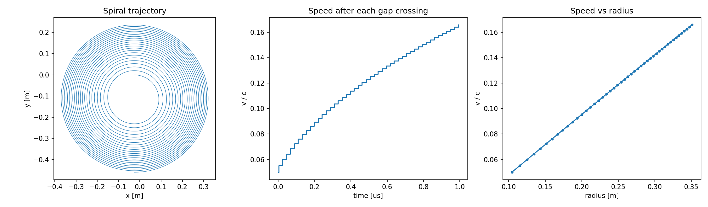

# Relativistic proton in a cyclotron

**Problem.** How does a proton gain energy in a cyclotron, how does its radius grow, and when does the constant-frequency assumption stop being valid?

**Method.** The equation `dp/dt = q(E + v × B)` with `v = p/(γm)` is integrated with RK4 (2000 steps per gyro-period). B = 1.5 T is uniform; E = 5 MV/m acts only in the gap between the dees and reverses with the particle's direction of motion (an ideal, phase-locked square wave). The proton is injected at 5 % of c and crosses the gap 46 times.

**Result.**

- final speed 4.97·10⁷ m/s (16.6 % of c), γ = 1.014, final radius 0.35 m, elapsed time 0.99 µs
- speed is linear in radius, as v = qBr/m predicts
- **validation:** every crossing adds exactly q·E₀·gap of kinetic energy, so the final energy should be KE₀ + 46·q·E₀·gap = 13.170 MeV. The simulation gives 13.174 MeV (relative difference 2.5·10⁻⁴, the small residue from the discrete gap boundary)

**Notes.** The model is idealised: no phase slip, fringe fields or vertical focusing. At 16 % of c the relativistic correction to the gyrofrequency is already ≈ 1.4 %, which is why a classical cyclotron cannot go much further.

Run: `python cyclotron.py`
