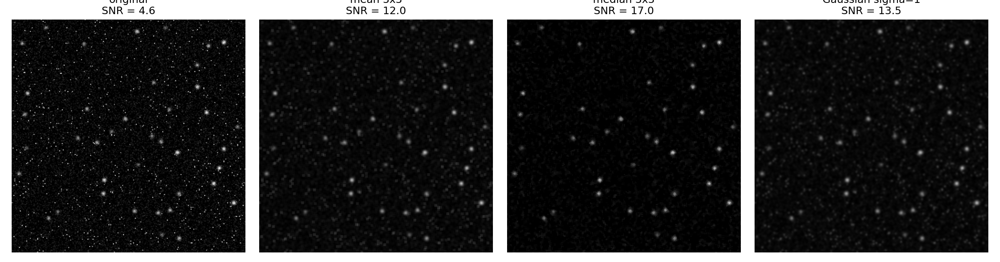

# Spatial filtering of astro-images

**Problem.** Night-sky images contain read noise and hot pixels. Which simple spatial filter removes the most noise while keeping the stars?

**Method.** Three filters from `scipy.ndimage`: 3×3 mean, 3×3 median and Gaussian (σ = 1). Quality is measured by `SNR = mean star-core signal / std of the star-free background`. The test image is a synthetic star field (40 Gaussian stars, Gaussian noise plus 1 % hot pixels), so the signal and background masks are known. The same code runs on a real photograph with `--image`.

**Result** (synthetic field, seed 0):

| filter | SNR | background std | star-core mean |
|---|---|---|---|
| original | 4.6 | 0.090 | 0.414 |
| mean 3×3 | 12.0 | 0.030 | 0.361 |
| Gaussian σ=1 | 13.5 | 0.025 | 0.342 |
| median 3×3 | 17.0 | 0.020 | 0.341 |

The median filter gives the best SNR here because it removes isolated hot pixels outright instead of spreading them. All three filters reduce star-core brightness by about 13–18 %, the cost of the noise reduction.

**Notes.** Results are on synthetic data and depend on the noise model. Run the script on your own image to get real-data numbers. For real images the masks come from percentiles of the image itself, so treat the SNR as a relative comparison between filters.

Run: `python spatial_filtering.py` or `python spatial_filtering.py --image your_image.jpg`
