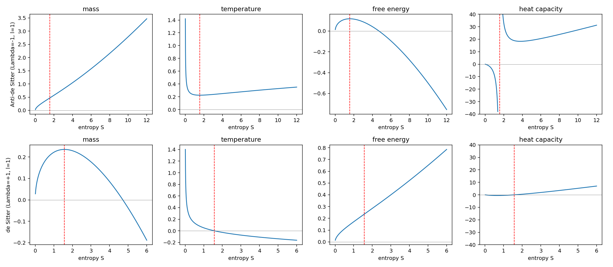

# Thermodynamics of a black hole with cosmological constant in bumblebee gravity

M.Sc. thesis (St. Xavier's College, Mumbai, 2021; supervisor Dr. Tharanath R). The full PDF is the primary document; this folder reproduces and checks the derivation symbolically.

**Problem.** In bumblebee gravity, a vector field with non-zero vacuum expectation value breaks Lorentz symmetry (parameter `l`). For a black hole with effective cosmological constant Λ, find the thermodynamic quantities as functions of entropy and judge stability from the heat capacity.

**Method.** The horizon condition f(r) = 0 gives M(r). With the area law S = πr², all other quantities follow from M(S): `T = dM/dS`, `F = M − TS`, `C = T/(dT/dS)`. The script derives these with sympy and plots them for anti-de Sitter (Λ = −1) and de Sitter (Λ = +1) with l = 1.

**Results.** Write a = (1 + l)Λ. Then

- `T = (π − aS) / (4π^{3/2} √S)`, which matches the thesis (Eq. 5.5)
- `C = −2S(π − aS)/(π + aS)`, a compact closed form
- **AdS (a < 0):** C diverges at S = π/|a| and is negative below it (small black holes unstable) and positive above it (large black holes stable). This is the small/large black-hole transition seen in the thesis.
- **dS (a > 0):** M > 0 and T > 0 only for S < π/a (the Nariai limit). Beyond that the horizon description no longer applies, so the negative mass and temperature in the original dS plots, which ran to S = 10, come from plotting outside the physical range.

Run: `python bumblebee_bh.py`
